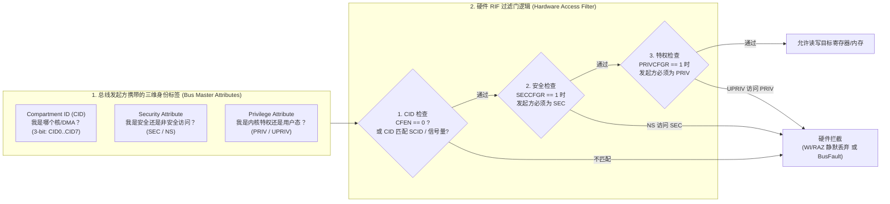
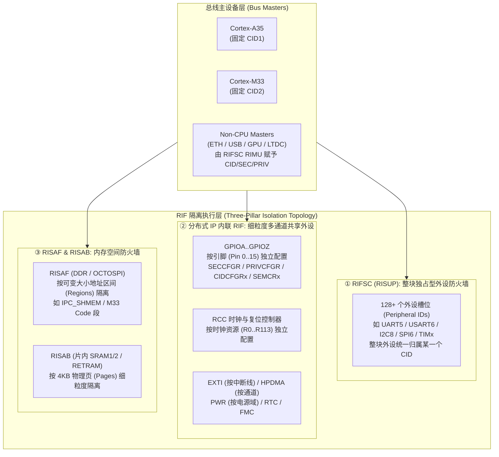

# STM32MP2 异构核硬件隔离架构（RIF）与外设主权深度指南

> **实验基线**：`STM32MP257F-DK` (`MB1605-C01`) | `OpenSTLinux 6.6` (`ca35tdcid-ostl-m33-examples-optee`) | `ATfE Clang 22.1.0 (C++26)`  
> **核心目标**：从真实硬件寄存器实验数据出发，彻底拆解 ST 的 **RIF (Resource Isolation Framework)** 设计哲学，并提炼出跨厂商（ST / NXP / TI / Renesas / Xilinx）异构 SoC 硬件资源获取的**第一性原理**。

---

## 目录

1. [第一部分：ST 特有的设计思路 —— STM32MP2 RIF 隔离机制全貌](#1-第一部分st-特有的设计思路--stm32mp2-rif-隔离机制全貌)
   - [1.1 为什么传统的 TrustZone 在异构多核 MPU 上不够用了？](#11-为什么传统的-trustzone-在异构多核-mpu-上不够用了)
   - [1.2 RIF 的三维正交权限模型：Security × Privilege × CID](#12-rif-的三维正交权限模型security--privilege--cid)
   - [1.3 皇权的核心：TDCID（Trusted Domain CID）与单点信任根](#13-皇权的核心tdcidtrusted-domain-cid与单点信任根)
   - [1.4 RIF 的空间拓扑：集中式防火墙（RIFSC/RISAF/RISAB）vs 分布式内联过滤](#14-rif-的空间拓扑集中式防火墙rifscrisafrisab-vs-分布式内联过滤)
   - [1.5 静态绑定（Static CID）vs 动态信号量抢占（Dynamic Semaphore）](#15-静态绑定static-cidvs-动态信号量抢占dynamic-semaphore)
   - [1.6 安全与非安全域地址映射（Alias）与硬件拦截行为（WI/RAZ vs BusFault）](#16-安全与非安全域地址映射alias与硬件拦截行为wiraz-vs-busfault)
2. [第二部分：第一性原理 —— 异构 SoC（ST/NXP/TI/Renesas/Xilinx）硬件资源获取的通用本质](#2-第二部分第一性原理--异构-socstnxptirenesasxilinx硬件资源获取的通用本质)
   - [2.1 第一定律：总线事务染色（Bus Transaction Tagging）](#21-第一定律总线事务染色bus-transaction-tagging)
   - [2.2 第二定律：粗粒度独占靠“总线门卫”，细粒度共享靠“IP 内联切片”或“资源管理核”](#22-第二定律粗粒度独占靠总线门卫细粒度共享靠ip-内联切片或资源管理核)
   - [2.3 第三定律：五大厂商异构资源隔离架构横向同构映射表](#23-第三定律五大厂商异构资源隔离架构横向同构映射表)
   - [2.4 第四定律：任何异构核驱动任何外设的“四层通关铁律”](#24-第四定律任何异构核驱动任何外设的四层通关铁律)
3. [第三部分：实测解剖 —— 逐位（Bit-by-Bit）破译 `trace0` 捕获的 `GPIOH` 硬件防线](#3-第三部分实测解剖--逐位bit-by-bit破译-trace0-捕获的-gpioh-硬件防线)
   - [3.1 完整实测数据回放](#31-完整实测数据回放)
   - [3.2 电源与时钟防线：`PWR_CR1 (0x00000300)` 与 `RCC_GPIOHCFGR (0x00000006)`](#32-电源与时钟防线pwr_cr1-0x00000300-与-rcc_gpiohcfgr-0x00000006)
   - [3.3 端口全局防线：`SECCFGR (0x0010)` 与 `PRIVCFGR (0x3FB0)`](#33-端口全局防线seccfgr-0x0010-与-privcfgr-0x3fb0)
   - [3.4 震撼现象揭秘：为什么 `MODER = 0x0FFC30F0` 中正在闪烁的蓝灯 `PH7` 读出来是 `0`？](#34-震撼现象揭秘为什么-moder--0x0ffc30f0-中正在闪烁的蓝灯-ph7-读出来是-0)
   - [3.5 逐位拆解 `CIDCFGRx` 的四种典型防御范式（`0x00` / `0x03` / `0x11` / `0x21`）](#35-逐位拆解-cidcfgrx-的四种典型防御范式0x00--0x03--0x11--0x21)
4. [第四部分：实战破局 —— M33 合法点亮 LED 或接管串口的最优雅路径](#4-第四部分实战破局--m33-合法点亮-led-或接管串口的最优雅路径)
   - [4.1 路径一（零设备树修改）：顺势而为，直接驱动已授信给 `CID2` 的 `PH6`（橙灯 `LD9`）](#41-路径一零设备树修改顺势而为直接驱动已授信给-cid2-的-ph6橙灯-ld9)
   - [4.2 路径二（跨核礼让共享）：动态信号量（`SEM_EN = 1`）的硬件抢占与释放协议](#42-路径二跨核礼让共享动态信号量sem_en--1的硬件抢占与释放协议)
   - [4.3 路径三（接管任意串口/外设）：先探针、后改 OP-TEE 设备树的治本之道](#43-路径三接管任意串口外设先探针后改-op-tee-设备树的治本之道)

---

## 1. 第一部分：ST 特有的设计思路 —— STM32MP2 RIF 隔离机制全貌

### 1.1 为什么传统的 TrustZone 在异构多核 MPU 上不够用了？

在单核 MCU（如 STM32H5 / STM32U5）或早期的 STM32MP157 上，硬件隔离只有两个传统维度：
1. **Security（安全态）**：`Secure (S)` vs `Non-Secure (NS)`（由 ARM TrustZone 提供）；
2. **Privilege（特权级）**：`Privileged (PRIV)` vs `Unprivileged (UPRIV)`（内核态 vs 用户态）。

然而，到了 **STM32MP257**，芯片内部塞进了**三个计算集群**（连同 DMA、GPU、NPU、USB、ETH 等十几个总线主设备 Bus Masters）：
- **Cortex-A35**（跑 OpenSTLinux + OP-TEE）
- **Cortex-M33**（跑实时裸机 / FreeRTOS / Zephyr，自带 M-profile TrustZone）
- **Cortex-M0+**（位于 SmartRun 低功耗域，处理待机唤醒）

如果依然只有 `Secure / Non-Secure` 二元划分，就会立刻陷入一个死局：
> **Linux 内核（CA35 Non-Secure）和实时固件（CM33 Non-Secure）都运行在 `Non-Secure` 态！**  
> 如果一个 GPIO 或 UART 被标记为 `Non-Secure`，那么 Linux 内核的某个驱动 bug（或者用户在 Linux 敲一行 `gpioset` / `devmem2`）就能随时覆盖 M33 正在做电机控制或倒立摆闭环的寄存器！反之，M33 的野指针也能把 Linux 的以太网或 eMMC 搞挂。

为了在**同一个安全域（同为 Non-Secure 或同为 Secure）内部**，把不同的处理器核彻底关进各自的“硬件沙箱”，ST 在 STM32MP2 中引入了 **RIF（Resource Isolation Framework，资源隔离框架）**。

---

### 1.2 RIF 的三维正交权限模型：`Security` × `Privilege` × `CID`

STM32MP2 的每一笔总线访问（AXI / AHB / APB），在硬件互联矩阵（BusMatrix / RIF Interconnect）上都携带一套**三维身份标签**，目标外设则拿着自己的寄存器配置与之做硬件级比对：



在 STM32MP2 架构中，硬件预定义了处理器的 **Compartment ID (`CID`)** 编号规范：

| CID 编号 | 架构固定角色与主设备归属 | 说明 |
|:---:|:---|:---|
| **`CID0`** | **未分配 / 初始复位态 (Reset / Open)** | 外设上电复位默认状态，或未启用 CID 过滤的通用主设备 |
| **`CID1`** | **Cortex-A35 处理器集群 (`CA35`)** | 包括运行在 CA35 上的 TF-A (`EL3`)、OP-TEE (`S-EL1`) 与 Linux (`NS-EL1/EL0`) |
| **`CID2`** | **Cortex-M33 处理器 (`CM33`)** | 包括 M33 的 Secure 态与 Non-Secure 态（你当前编译的固件即运行在 **`CID2 + NS + PRIV`**） |
| **`CID3`** | **Cortex-M0+ 处理器 (`CM0+`)** | LPD (Low-Power Domain) 低功耗协处理器 |
| **`CID4..7`** | **其他系统总线主设备 (DMA / GPU / ETH 等)** | 由 `RIFSC` 中的 `RIMU`（Resource Isolation Master Unit）动态赋予或继承发起核的 CID |

> **核心洞见**：`CID` 与 `SEC/NS` 是**完全正交**的！  
> - **OP-TEE** 的总线身份是：`CID = 1` + `SEC = 1` + `PRIV = 1`  
> - **Linux Kernel** 的总线身份是：`CID = 1` + `SEC = 0 (NS)` + `PRIV = 1`  
> - **你的 M33 固件** 的总线身份是：`CID = 2` + `SEC = 0 (NS)` + `PRIV = 1`（Cortex-M33 启动后默认运行在 Handler / Privileged Thread 模式）

---

### 1.3 皇权的核心：`TDCID`（Trusted Domain CID）与单点信任根

既然有 `CID1 (CA35)` 和 `CID2 (CM33)`，那么一个最本质的政治问题来了：**谁有权修改 `SECCFGR`、`CIDCFGR` 这些权限配置寄存器本身？**

如果 `CID2 (CM33)` 可以随便写 `GPIOH->CIDCFGR7 = 0x21`，把原本属于 Linux 的引脚抢过来，那隔离机制就形同虚设。为此，ST 发明了 **`TDCID`（Trusted Domain Compartment ID，受信任主控域 ID）**：

1. **谁是 `TDCID` 由启动拨码开关 (`BOOT0..3`) 在上电瞬间由 BootROM 硬件锁定**：
   - 在你当前的开发板上，刷写的是 `FlashLayout_sdcard_stm32mp257f-dk-ca35tdcid-ostl-m33-examples-optee.tsv`。注意文件名里的 **`ca35tdcid`**！
   - 这意味着系统以 **CA35 TD（Trusted Domain）模式** 启动，硬件将 **`TDCID` 永久焊死为 `CID1` (`CA35`)**（除非更改拨码开关走 `cm33tdcid` 启动流）。
2. **修改任何 RIF 隔离配置的唯一合法身份**：
   - 必须同时满足：**`当前发起者 CID == TDCID (CID1)` + `Secure (SEC = 1)` + `Privileged (PRIV = 1)`**！
   - 换句话说，在 `ca35tdcid` 模式下：
     - **M33 (`CID2`) 永远只能“只读” `SECCFGR` / `CIDCFGR`，绝对无法篡改它们**（写操作会被硬件直接忽略）；
     - **甚至连 Linux 内核 (`CID1 + NS`) 也无法通过 `devmem2` 修改 `CIDCFGR`**，因为 Linux 是 `Non-Secure (NS)`！
     - 全芯片**唯一**手握“尚方宝剑”能够划分外设归属的，只有运行在 `CA35 Secure EL1` 的 **OP-TEE OS**（以及更早期的 TF-A BL2）！

---

### 1.4 RIF 的空间拓扑：集中式防火墙（`RIFSC`/`RISAF`/`RISAB`）vs 分布式内联过滤

很多开发者看 RM0457 手册最头晕的地方在于：为什么有时候去 `RIFSC` 里找外设权限，有时候又要到 `GPIOH`、`RCC` 自己的寄存器里找权限？

答案极其清晰——**取决于外设的“资源颗粒度”**。ST 将全芯片硬件资源切分为三大类隔离组件：



1. **第一类：整块独占型外设 $\rightarrow$ 归 `RIFSC` 中的 `RISUP`（Slave Unit Peripherals）管辖**
   - 比如 `UART5`、`I2C8`、`SPI6`、`TIM2`。你不可能让 CA35 发送 `UART5` 的前一半字节、M33 发送后一半字节——整台 `UART5` 控制器在任一时刻必然归属于某一个核。
   - 因此，`UART5` 自身内部没有 `CIDCFGR` 寄存器，它的门卫统一坐在 **`RIFSC`（基址 `0x42080000`）** 里，按外设 ID 集中配置。
2. **第二类：多路复用共享型系统 IP $\rightarrow$ 归 IP 内部的“分布式内联 RIF 寄存器”管辖**
   - 典型代表：**`GPIOA..Z`（16 个引脚由不同核瓜分）**、**`RCC`（上百个外设时钟门控）**、**`EXTI`（中断线）**、**`PWR`（电源轨）**、**`HPDMA`（16 个 DMA 通道）**。
   - 如果把整个 `GPIOH` 封死给 Linux，M33 就连 `PH6` 上的橙灯都点不亮！因此 ST 必须把 `SECCFGR`、`PRIVCFGR`、`CIDCFGRx`、`SEMCRx` **直接做进 `GPIO_TypeDef` 结构体内部**，实现“一脚一权（Per-Pin Isolation）”。
3. **第三类：存储器空间 $\rightarrow$ 归 `RISAF`（DDR/Flash 区域）与 `RISAB`（SRAM 4KB 页）管辖**
   - 你的 M33 固件之所以能跑在 DDR 的 `0x80100000`，且能通过 `IPC_SHMEM_1` 与 Linux 共享 `trace_buffer`，正是因为 OP-TEE 在启动时配置了 **`RISAF4`（DDR 防火墙）**，把 `0x80100000` 划给了 `CID2 (CM33)`，把 `IPC_SHMEM` 划为了 `CID1 + CID2` 共享非安全区！

---

### 1.5 静态绑定（Static CID）vs 动态信号量抢占（Dynamic Semaphore）

在 `GPIOH->CIDCFGRx`（以及 `RIFSC`、`RCC` 等所有 RIF 单元）中，每个资源都支持三种分配模式，由最低两位 `CFEN` (Bit 0) 和 `SEM_EN` (Bit 1) 决定：

| `CFEN` (Bit 0) | `SEM_EN` (Bit 1) | 模式名称 | 硬件放行条件（除 `SEC`/`PRIV` 外） | 典型工程场景 |
|:---:|:---:|:---|:---|:---|
| **`0`** | `X` | **开放模式 (Open Mode)** | **不检查 CID**，任何 CID 均可访问 | 无冲突的非关键资源，或调试阶段完全敞开 |
| **`1`** | **`0`** | **静态 CID 绑定 (Static CID)** | 发起方 `CID` 必须严格等于 `CIDCFGR.SCID[5:4]` | 95% 的常见场景：`PH6` 静态归 `CID2 (M33)`，`PH7` 静态归 `CID1 (CA35)` |
| **`1`** | **`1`** | **动态信号量抢占 (Semaphore Mode)** | 1. 发起方 `CID` 在白名单 `SEMWLC[19:16]` 中为 `1`<br>2. 向 `SEMCR.SEM_MUTEX` 写 `1` 抢锁成功，使 `SEMCR.SEMCID == 自身 CID` | 两个核需要分时复用同一个外设/引脚；或者**把白名单设为 `0` (`SEMWLC=0`) 作为废弃引脚的“绝对硬件死锁”** |

> **为什么 ST 要在硬件寄存器里再造一个 `SEMCR` 信号量，而不是用传统的 `HSEM`（硬件信号量外设）？**  
> 因为传统的 `HSEM` 只是“君子协定”——即便 M33 没去 `HSEM` 拿锁，只要它强行写 `GPIO` 寄存器，硬件依然会执行！  
> 而 RIF 的 **`SEMCR` 是与总线访问权限强绑定的“物理门锁”**：当 `CFEN=1, SEM_EN=1` 时，只有当前在 `SEMCR.SEMCID` 中登记了名字的那个 `CID`，硬件总线才允许它的写事务通过；释放信号量后，该核立刻失去对该引脚的写权限！

---

### 1.6 安全与非安全域地址映射（Alias）与硬件拦截行为（`WI/RAZ` vs `BusFault`）

在 STM32MP257 的内存映射中，所有外设都同时拥有两个物理别名地址（Address Aliasing）：
- **Non-Secure 别名区间**：`0x4000_0000` 起（例如 `GPIOH_BASE_NS = 0x442B_0000`）
- **Secure 别名区间**：`0x5000_0000` 起（例如 `GPIOH_BASE_S = 0x542B_0000`，最高位 Bit 28 置 `1`）

当你在 M33 的 Non-Secure 固件中使用 CMSIS 宏 `GPIOH` 时，头文件 `stm32mp257fxx_cm33.h` 根据未定义 `CPU_IN_SECURE_STATE`，自动将其展开为 **`GPIOH_NS` (`0x442B_0000`)**。

当 M33 发起一笔越权访问时，硬件有两种截然不同的惩罚手段：
1. **静默过滤 `WI/RAZ`（Write Ignored / Read As Zero，写忽略、读归零）**：
   - 在 `GPIO`、`RCC`、`PWR` 等共享 IP 内部，如果 M33 只是去读写不属于自己的引脚位（例如读 `GPIOH->MODER` 中属于 CA35 的 `PH7`，或者去写 `GPIOH->CIDCFGR7`），**不会触发 HardFault / BusFault 导致 M33 死机**，而是读回来永远是 `0`（RAZ），写进去永远无效（WI）。这也是为什么我们的探针程序能够安全遍历全部 16 个引脚而不崩溃！
2. **总线异常 `BusFault / IAC`（Illegal Access Controller）**：
   - 如果 M33 (`NS`) 企图直接访问 `0x542B_0000`（Secure 别名地址），或者直接读写被 `RISAF`/`RISAB` 彻底封禁的 DDR/SRAM 区域，总线矩阵会直接返回 `DECERR/SLVERR` 触发 **M33 BusFault / SecureFault**，同时触发 `SERC`（System Error Controller）向 OP-TEE 报警。

---

## 2. 第二部分：第一性原理 —— 异构 SoC（ST/NXP/TI/Renesas/Xilinx）硬件资源获取的通用本质

如果你跳出 ST 的手册术语（`RIF`、`CID`、`TDCID`、`RISAF`），站在芯片架构师的上帝视角审视市面上所有的主流异构多核 SoC（**ST STM32MP2、NXP i.MX8M / i.MX93、TI Sitara AM62x / AM64x、Renesas RZ/G2L、AMD-Xilinx Zynq UltraScale+ MPSoC**），你会发现它们解决的完全是**同一个物理问题**，遵循着**完全一致的第一性原理**。

### 2.1 第一定律：总线事务染色（Bus Transaction Tagging）

**本质矛盾**：CPU 核执行一条 `STR R0, [R1]` 机器码时，发往片上网络（NoC / AXI Interconnect）的只是一串地址和数据电信号。一旦离开 CPU 核的端口，目标外设怎么知道这笔写操作是 Cortex-A 发的，还是 Cortex-M 发的，还是某个被黑客控制的网卡 DMA 发的？

**通用解法**：所有异构 SoC 都必须在每个 Master 踏入总线矩阵的第一步，在硬件侧带信号（AXI Sideband Signals / `AxUSER`）上给这笔事务打上**不可伪造的出厂身份钢印**。
- ST 把这个钢印叫做 **`CID` (Compartment ID)**；
- NXP (i.MX8ULP / i.MX93) 把它叫做 **`DID` (Domain ID)**；
- TI (AM62x / AM64x K3 架构) 把它叫做 **`PrivID` (Privilege ID)**；
- AMD-Xilinx (Zynq MPSoC) 把它叫做 **`MasterID` / `SMID`**。

### 2.2 第二定律：粗粒度独占靠“总线门卫”，细粒度共享靠“IP 内联切片”或“资源管理核”

所有异构芯片的外设都面临同一个拓扑分叉：
1. **独占型外设（UART / SPI / I2C / CAN）**：直接在外设 APB/AXI 从端口前放一个**通用总线防火墙（Peripheral Access Firewall）**，对比事务上的 `CID/DID/PrivID` 即可。
2. **切片共享型基础设施（Pinmux / GPIO / Clock / Reset / Power / DMA / Interrupt Router）**：
   因为 A 核和 M 核都要用时钟、都要用引脚、都要用 DMA 通道，绝不能一刀切封死整个外设基地址。芯片界对此演化出了**两大流派**：
   - **流派 A：硬件内联切片派（ST STM32MP2 RIF / NXP i.MX93 TRDC）**  
     把权限寄存器下沉到 IP 内部——每个 GPIO 引脚、每个 RCC 时钟门控、每个 DMA 通道都自带一份 `CIDCFGR` 硬件锁。优点是 M 核可以直接操作寄存器、零通信延迟、实时性极佳；代价是寄存器数量膨胀、硬件面积大。
   - **流派 B：中央集权 RPC 代理派（TI K3 `SYSFW/TIFS` / NXP i.MX8QXP `SCFW`）**  
     干脆不让 A 核和 M 核直接碰时钟/电源/引脚控制器！芯片里专门塞一个微型管理核（如 TI 的 DMSC Cortex-M3/M4 或 NXP 的 SCU/ELE），A 核和 M 核想开时钟或申请外设，必须通过硬件邮箱（Mailbox / TISCI 协议）向中央管理核发消息申请，管理核校验权限后代为操作。

### 2.3 第三定律：五大厂商异构资源隔离架构横向同构映射表

当你掌握了 STM32MP2 的 RIF，你就同时掌握了另外四家巨头的异构隔离架构，它们只是换了一套马甲：

| 架构概念（第一性原理） | ST STM32MP2 (`RIF`) | NXP i.MX8ULP / i.MX93 (`TRDC` / `XRDC`) | TI Sitara AM62x / AM64x (`K3 Firewall`) | AMD-Xilinx Zynq UltraScale+ (`XMPU` / `XPPU`) | Renesas RZ/G2L (`TZC` / `CPG`) |
|:---|:---|:---|:---|:---|:---|
| **主设备身份钢印** | **`CID`** (`CID0..7`) | **`DID`** (Domain ID `0..15`) | **`PrivID`** (Privilege ID) | **`MasterID` / `SMID`** (`10-bit`) | TrustZone `NSAID` / Master Tag |
| **最高裁决权持有者** | **`TDCID` 上的 OP-TEE** (`CA35 S-EL1` 或 `CM33-S`) | **ELE (EdgeLock Enclave)** / Sentinel 安全核 | **TIFS / DM** (Device Manager 专核) | **PMU / CSU** + `ATF (BL31)` | `TF-A (BL31)` + `OP-TEE` |
| **DMA/非CPU主设备染色器** | **`RIFSC - RIMU`** (Master Unit) | **`TRDC - MDAC`** (Master Domain Assignment) | `QoS /RAT / NAVSS` Master Table | `SMMU / TZ / Master ID` 表 | AXI Access Control |
| **独占外设防火墙** | **`RIFSC - RISUP`** (Slave Unit Peripherals) | **`TRDC - PAC`** (Peripheral Access Controller) | **CBASS Peripheral Firewalls** | **`XPPU`** (Xilinx Peripheral Protection Unit) | Slave Access Control (`ACCCNT`) |
| **DDR / 大内存区间防火墙** | **`RISAF`** (Address Space Full) | **`TRDC - MRC`** (Memory Region Controller) | **DDR / MSMC CBASS Firewalls** | **`XMPU`** (Xilinx Memory Protection Unit) | `TZC-400` (TrustZone Address Space Controller) |
| **片内 SRAM 页级防火墙** | **`RISAB`** (4KB Page Blocks) | **`TRDC - MBC`** (Memory Block Controller) | `OCSRAM Firewalls` | `OCM XMPU` (按块保护) | SRAM Access Control |
| **多核动态共享锁机制** | **IP 内联 `SEMCR`** + `HSEM` | **`SEMA42`** (Hardware Semaphores) + `MU` | **`Spinlock`** 模块 + `TISCI` 资源租借 | **`XPPU Aperture`** + RPU/APU IPI | `MHU` (Message Handling Unit) |

### 2.4 第四定律：任何异构核驱动任何外设的“四层通关铁律”

无论你在哪家异构芯片的 M 核上写裸机/RTOS 代码，当你发现“写寄存器没反应”或“一读就卡死/进 Fault”时，永远不需要盲目翻几千页手册，只需按以下**四层物理因果链**自下而上排查：

1. **第一层：供电域使能与有效确认（Power Domain & IO Supply Valid）**
   - 引脚所在的独立电源轨（如 STM32MP2 的 `VDDIO1/2/3/4`）供电了吗？`PWR` 里的 Supply Valid 开关（如 `PWR_CR1.VDDIO3SV`）合上了吗？如果没合上，芯片内部模拟隔离栅（Isolation Cell）处于断开状态，数字逻辑再对也无法传到外部焊盘。
2. **第二层：时钟门控与复位释放（Clock Gate & Reset De-assertion）**
   - 外设的 APB/AHB 总线时钟（如 `RCC->GPIOHCFGR.GPIOxEN`）开了吗？复位位（`GPIOxRST`）释放为 `0` 了吗？没开时钟读寄存器必然返回 `0` 或挂死总线。
3. **第三层：异构隔离防火墙放行（Isolation Firewall / RIF Ownership）**
   - 集中式防火墙（`RIFSC->RISUP`）或分布式防火墙（`GPIO->SECCFGR` / `PRIVCFGR` / `CIDCFGRx`）是否允许当前核的身份（如 M33 的 `CID2 + NS + PRIV`）读写？
4. **第四层：引脚复用与外设功能配置（Pinmux `MODER`/`AFR` & Peripheral `CR`）**
   - 只有前 3 层全部通关，你在 HAL 库里写的 `HAL_GPIO_Init()`、`HAL_UART_Init()` 才真正能够落到物理触发器上！

---

## 3. 第三部分：实测解剖 —— 逐位（Bit-by-Bit）破译 `trace0` 捕获的 `GPIOH` 硬件防线

### 3.1 完整实测数据回放

以下是我们在 [main.cpp](file:///c:/tzy/projects/stm32mp257f-dk-m33/00-example/main.cpp) 中运行 `ProbeGpioHRifPermissions()` 后，M33 核通过 `IPC_SHMEM_1` 的 `trace0` 管道传回的板载真实寄存器快照：

```text
================ GPIOH RIF Permission Probe ================
[PWR_CR1]       0x00000300 | VDDIO3: VMEN=0 SV=1 RDY=0 VRSEL=0
[RCC_GPIOHCFGR] 0x00000006 | EN=1 LPEN=1 RST=0
[GPIOH Global]  SECCFGR=0x0010 PRIVCFGR=0x3FB0 LOCKR=0x0000
                MODER=0x0FFC30F0 ODR=0x0000 IDR=0x0000
------------------------------------------------------------
Pin | Mode/IO | SEC/PRV | CIDCFGR    | SEMCR  | Owner/Mode        | M33 Verdict          | Board Net
----+---------+---------+------------+--------+-------------------+----------------------+-------------------------
PH0 | IN  0/0 | NS /UPR | 0x00000003 | 0x0000 | SemWL:0 Free:C0   | DENY(Not in SEM_WL)  | NC
PH1 | IN  0/0 | NS /UPR | 0x00000003 | 0x0000 | SemWL:0 Free:C0   | DENY(Not in SEM_WL)  | NC
PH2 | ANA 0/0 | NS /UPR | 0x00000021 | 0x0000 | Static:CID2(CM33) | ALLOW(Static CID2)   | USBSW_OE (FUSB340)
PH3 | ANA 0/0 | NS /UPR | 0x00000021 | 0x0000 | Static:CID2(CM33) | ALLOW(Static CID2)   | USBSW_S  (FUSB340)
PH4 | IN  0/0 | SEC/PRV | 0x00000011 | 0x0000 | Static:CID1(CA35) | DENY(Secure-Only)    | LD7_RED  (LED1/BOOTFAILN)
PH5 | IN  0/0 | NS /PRV | 0x00000011 | 0x0000 | Static:CID1(CA35) | DENY(Static != CID2) | LD8_GRN  (LED2)
PH6 | ANA 0/0 | NS /UPR | 0x00000021 | 0x0000 | Static:CID2(CM33) | ALLOW(Static CID2)   | LD9_ORG  (LED3 M33默认)
PH7 | IN  0/0 | NS /PRV | 0x00000011 | 0x0000 | Static:CID1(CA35) | DENY(Static != CID2) | LED1_BLU (LED4 Linux心跳)
PH8 | IN  0/0 | NS /PRV | 0x00000011 | 0x0000 | Static:CID1(CA35) | DENY(Static != CID2) | CN5_P31  (TIM5_CH1)
PH9 | ANA 0/0 | NS /PRV | 0x00000021 | 0x0000 | Static:CID2(CM33) | ALLOW(Static CID2)   | ETH1_CLK125
PH10| ANA 0/0 | NS /PRV | 0x00000021 | 0x0000 | Static:CID2(CM33) | ALLOW(Static CID2)   | ETH1_TXD2
PH11| ANA 0/0 | NS /PRV | 0x00000021 | 0x0000 | Static:CID2(CM33) | ALLOW(Static CID2)   | ETH1_TXD3
PH12| ANA 0/0 | NS /PRV | 0x00000021 | 0x0000 | Static:CID2(CM33) | ALLOW(Static CID2)   | ETH1_RXD2
PH13| ANA 0/0 | NS /PRV | 0x00000021 | 0x0000 | Static:CID2(CM33) | ALLOW(Static CID2)   | ETH1_RXD3
PH14| IN  0/0 | NS /UPR | 0x00000000 | 0x0000 | CFEN=0 (All CID)  | ALLOW(CFEN=0 Open)   | NC
PH15| IN  0/0 | NS /UPR | 0x00000000 | 0x0000 | CFEN=0 (All CID)  | ALLOW(CFEN=0 Open)   | NC
============================================================
```

---

### 3.2 电源与时钟防线：`PWR_CR1 (0x00000300)` 与 `RCC_GPIOHCFGR (0x00000006)`

1. **`PWR->CR1 = 0x0000_0300`**（二进制 `0000_0011_0000_0000`）：
   - **Bit 8 (`VDDIO3SV = 1`)**：`VDDIO3` 独立电源域（给 `PH2..PH13` 供电，板载接 $3.3\text{ V}$ `VDDIO`）**供电有效开关已闭合**！因为板载 `VDDIO3` 直连常电 `VDDIO` 而不经过可调 LDO，所以无需开启电压比较器监控（`Bit 0 VDDIO3VMEN = 0`），OP-TEE 启动时直接置位了 `VDDIO3SV = 1` 解除引脚模拟隔离。
   - **Bit 9 (`VDDIO4SV = 1`)**：同理，`VDDIO4` 电源域也已被置为有效。
   - **Bit 25 (`VDDIO3VRSEL = 0`)**：工作在 $3.3\text{ V}$ 标准电压档位（若为 `1` 则为 $1.8\text{ V}$ 低压高速档）。
2. **`RCC->GPIOHCFGR = 0x0000_0006`**（二进制 `0110`）：
   - **Bit 0 (`GPIOxRST = 0`)**：`GPIOH` 未处于复位状态。
   - **Bit 1 (`GPIOxEN = 1`)**：`GPIOH` 寄存器总线时钟已开启。
   - **Bit 2 (`GPIOxLPEN = 1`)**：低功耗睡眠模式下 `GPIOH` 时钟同样保持开启。

---

### 3.3 端口全局防线：`SECCFGR (0x0010)` 与 `PRIVCFGR (0x3FB0)`

将 16 位寄存器按引脚 `PH15 .. PH0` 展开成二进制位图：

| 引脚号 | `PH15` | `PH14` | `PH13` | `PH12` | `PH11` | `PH10` | `PH9` | `PH8` | `PH7` | `PH6` | `PH5` | `PH4` | `PH3` | `PH2` | `PH1` | `PH0` |
|:---|:---:|:---:|:---:|:---:|:---:|:---:|:---:|:---:|:---:|:---:|:---:|:---:|:---:|:---:|:---:|:---:|
| **板载功能** | NC | NC | ETH1 | ETH1 | ETH1 | ETH1 | ETH1 | CN5 | **蓝灯** | **橙灯** | **绿灯** | **红灯** | USBSW | USBSW | NC | NC |
| **`SECCFGR = 0x0010`** | `0` | `0` | `0` | `0` | `0` | `0` | `0` | `0` | `0` | `0` | `0` | **`1`** | `0` | `0` | `0` | `0` |
| **`PRIVCFGR = 0x3FB0`** | `0` | `0` | **`1`** | **`1`** | **`1`** | **`1`** | **`1`** | **`1`** | **`1`** | `0` | **`1`** | **`1`** | `0` | `0` | `0` | `0` |

- **为什么唯独 `PH4` (`SECCFGR` Bit 4 = `1`) 是 `Secure`？**  
  原理图揭示：`PH4` 既是红灯 `LD7`，又是芯片硬件启动失败指示脚 **`BOOTFAILN`**。TF-A 与 OP-TEE 将其设为 **Secure 独占**，用作最高安全等级的 Panic / Boot Fail 故障报警灯，严禁任何 Non-Secure 软件（包括 Linux 内核与 M33 固件）篡改。
- **为什么 `PH6`（橙灯）和 `PH2/PH3`（USB3.0 切换开关）的 `PRIVCFGR` 是 `0` (`UPR`)？**  
  因为 Starter Package 中的 M33 官方示例是 `USBPD_DRP_UCSI`（通过 `PH2/PH3` 控制 `FUSB340` 正反插开关，通过 `PH6` 橙灯指示状态）。为了允许 M33 在跑 RTOS 非特权任务（Unprivileged Thread）时也能直接翻转这几个引脚，OP-TEE 特意将 `PH2, PH3, PH6` 的特权要求降为了 `0 (UPR)`！

---

### 3.4 震撼现象揭秘：为什么 `MODER = 0x0FFC30F0` 中正在闪烁的蓝灯 `PH7` 读出来是 `0`？

把实测读出的 `GPIOH->MODER = 0x0FFC_30F0` 按每引脚 2-bit (`MODER15 .. MODER0`) 拆开：

$$
\texttt{0x0FFC30F0} = \underbrace{\texttt{00}}_{\text{PH15}} \ \underbrace{\texttt{00}}_{\text{PH14}} \ \underbrace{\texttt{11}}_{\text{PH13}} \ \underbrace{\texttt{11}}_{\text{PH12}} \ \underbrace{\texttt{11}}_{\text{PH11}} \ \underbrace{\texttt{11}}_{\text{PH10}} \ \underbrace{\texttt{11}}_{\text{PH9}} \ \underbrace{\texttt{00}}_{\text{PH8}} \ \underbrace{\texttt{00}}_{\text{PH7}} \ \underbrace{\texttt{11}}_{\text{PH6}} \ \underbrace{\texttt{00}}_{\text{PH5}} \ \underbrace{\texttt{00}}_{\text{PH4}} \ \underbrace{\texttt{11}}_{\text{PH3}} \ \underbrace{\texttt{11}}_{\text{PH2}} \ \underbrace{\texttt{00}}_{\text{PH1}} \ \underbrace{\texttt{00}}_{\text{PH0}}
$$

请仔细对比上面两张表，你会发现一个令人拍案叫绝的硬件规律：
1. **凡是归属于 `CID2 (CM33)` 的已引出引脚（`PH2, PH3, PH6, PH9..PH13`）**：读出来的 `MODER` 全部是 `0b11`（`Analog` 模拟高阻模式，即 STM32 GPIO 上电复位的真实物理默认值）！
2. **凡是不归属于 `CID2 (CM33)` 的引脚（`PH0, PH1, PH4, PH5, PH7, PH8`）**：读出来的 `MODER` 全部是 `0b00`！
   - 要知道，此时开发板上的蓝灯 **`PH7` 正在受 Linux 心跳驱动一闪一闪地发光**！它在物理硬件寄存器里的真实 `MODER7` 绝对是 `0b01 (Output)`，`ODR7`/`IDR7` 也在不断在 `0` 和 `1` 之间翻转！
   - 但是当 **M33 (`CID2`)** 去读 `GPIOH->MODER`、`GPIOH->ODR`、`GPIOH->IDR` 时，**硬件 RIF 读多路选择器（Read Masking Logic）在总线上实时把 `PH7` 对应的比特位强制抹成了 `0`（RAZ，Read-As-Zero）**！
   - 这不仅防止了 M33 误写 Linux 的引脚，甚至从物理层面杜绝了 M33 **旁路窥探（Side-Channel Snooping）** Linux 引脚上的通信数据或状态！

---

### 3.5 逐位拆解 `CIDCFGRx` 的四种典型防御范式（`0x00` / `0x03` / `0x11` / `0x21`）

`GPIO_CIDCFGRx` 寄存器的位域定义如下：
- **Bit 0 (`CFEN`)**：CID 过滤总开关（`0` = 关闭过滤，`1` = 开启过滤）
- **Bit 1 (`SEM_EN`)**：信号量模式开关（`0` = 静态 SCID 模式，`1` = 动态信号量模式）
- **Bits [5:4] (`SCID`)**：静态主权 CID 编号（`0..3`）
- **Bits [19:16] (`SEMWLC3..0`)**：动态信号量白名单（Bit 16 对应 `CID0`，Bit 17 对应 `CID1`，Bit 18 对应 `CID2`，Bit 19 对应 `CID3`）

我们在 `trace0` 中恰好捕获到了 OP-TEE 使用的**全部四种标准工程配置范式**：

| 实测十六进制值 | 二进制位拆解 (`SEMWLC` / `SCID` / `SEM_EN` / `CFEN`) | 涉及引脚 | 硬件防线真实意图（ST 官方设备树惯用法） |
|:---:|:---|:---|:---|
| **`0x00000021`** | `SCID = 2 (0b10)`<br>`SEM_EN = 0`<br>`CFEN = 1` | **`PH2, PH3, PH6, PH9..13`** | **范式一：M33 静态专属领地 (`Static CID2`)**。<br>OP-TEE 明确将这些引脚划拨给 Cortex-M33 (`CID2`) 独占使用。M33 可随时直接读写其 `MODER/ODR/BSRR/AFR`。 |
| **`0x00000011`** | `SCID = 1 (0b01)`<br>`SEM_EN = 0`<br>`CFEN = 1` | **`PH4, PH5, PH7, PH8`** | **范式二：CA35 静态专属领地 (`Static CID1`)**。<br>划拨给 Cortex-A35 (`CID1`)。其中 `PH4` 额外叠加了 `SECCFGR=1` 留给 OP-TEE；`PH5/7/8` 为 `NS` 留给 Linux 内核。M33 对它们读写全部触发 `WI/RAZ`。 |
| **`0x00000003`** | `SEMWLC = 0x0 (0b0000)`<br>`SEM_EN = 1`<br>`CFEN = 1` | **`PH0, PH1`** | **范式三：“空名单信号量”硬件死锁 (`Locked Unused Pin`)**。<br>这是 ST 极其巧妙的一个防御技巧：开启 `CFEN=1` 和信号量模式 `SEM_EN=1`，但**把白名单 `SEMWLC[19:16]` 设为全 `0`**！这意味着没有任何一个核（无论 CA35 还是 CM33）在白名单里，谁也拿不到信号量，从而把未引出的悬空脚彻底锁死。 |
| **`0x00000000`** | `CFEN = 0` | **`PH14, PH15`** | **范式四：未受限开放态 (`Open Mode`)**。<br>`STM32MP257FAK3` 封装中 `PH14/PH15` 内部未绑定物理焊盘，未启用 CID 过滤。 |

---

## 4. 第四部分：实战破局 —— M33 合法点亮 LED 或接管串口的最优雅路径

理解了上述原理与实测数据后，你在 STM32MP257F-DK 上做任何 M33 外设开发，都只需对号入座以下三条路径：

### 4.1 路径一（零设备树修改）：顺势而为，直接驱动已授信给 `CID2` 的 `PH6`（橙灯 `LD9`）

从探针结果可知：**`PH6`（板载橙色 LED `LD9`，高电平点亮）当前已经是 `CIDCFGR6 = 0x00000021` (`ALLOW(Static CID2)`)，且 `VDDIO3SV = 1`、`RCC_GPIOHCFGR.EN = 1`**！

这意味着你**不需要改任何 Linux/OP-TEE 配置**，直接在 M33 的 [main.cpp](file:///c:/tzy/projects/stm32mp257f-dk-m33/00-example/main.cpp) 中加入以下 10 行代码，板载橙灯 `LD9` 就会立刻听从 M33 指挥闪烁，而且此时再去读 `GPIOH->MODER` 和 `ODR`，你会亲眼看到 `PH6` 变成 `OUT 1/1`：

```cpp
// 初始化 PH6 (LD9 橙灯) 为推挽输出
GPIO_InitTypeDef led_init{};
led_init.Pin   = GPIO_PIN_6;
led_init.Mode  = GPIO_MODE_OUTPUT_PP;
led_init.Pull  = GPIO_NOPULL;
led_init.Speed = GPIO_SPEED_FREQ_LOW;
HAL_GPIO_Init(GPIOH, &led_init);

// 在主循环中翻转橙灯 LD9
while (true) {
  HAL_GPIO_TogglePin(GPIOH, GPIO_PIN_6);
  HAL_Delay(500);
}
```

---

### 4.2 路径二（跨核礼让共享）：动态信号量（`SEM_EN = 1`）的硬件抢占与释放协议

如果某个引脚在 OP-TEE 中被配置为 CA35 与 CM33 共享（例如 `CIDCFGRx = 0x0006_0003`，即 `CFEN=1, SEM_EN=1, SEMWLC = 0b0110` 允许 `CID1` 和 `CID2` 抢占），M33 在操作该引脚前必须执行标准的**硬件信号量握手协议**：

```cpp
// 1. M33 (CID2) 尝试向 SEMCRx 的 Bit 0 (SEM_MUTEX) 写 1 申请硬件锁
GPIOH->SEMCR6 = GPIO_SEMCR6_SEM_MUTEX;

// 2. 读回 SEMCRx 校验：不仅 MUTEX 要为 1，且当前持有者 SEMCID[5:4] 必须等于 2 (CID2)
if ((GPIOH->SEMCR6 & (GPIO_SEMCR6_SEM_MUTEX_Msk | GPIO_SEMCR6_SEMCID_Msk)) ==
    (GPIO_SEMCR6_SEM_MUTEX | (2U << GPIO_SEMCR6_SEMCID_Pos))) {
  // 抢锁成功！此时硬件总线已对 CID2 放行，可安全操作 PH6
  HAL_GPIO_WritePin(GPIOH, GPIO_PIN_6, GPIO_PIN_SET);

  // 3. 用完归还硬件锁（向 SEM_MUTEX 写 0），归还后 M33 立即失去写权限
  GPIOH->SEMCR6 = 0U;
}
```
> 注：STM32MP2 HAL 库中也封装了对应的宏 `HAL_GPIO_TakePinSemaphore()` 与 `HAL_GPIO_ReleasePinSemaphore()`，底层就是上述三步寄存器操作。

---

### 4.3 路径三（接管任意串口/外设）：先探针、后改 OP-TEE 设备树的治本之道

假设你接下来想让 M33 接管板载 **ST-LINK 的第二路虚拟串口 `UART5`（`PG9 = TX`, `PG10 = RX`）** 或 **40-Pin 排针 `CN5` 上的 `USART6`（`PF13 = TX`, `PF14 = RX`）**，最优雅、零内耗的工程路径只有两步：

#### 第一步：用 M33 探针直接看穿当前固件的底牌（耗时 1 分钟）
不查复杂的设备树源码，直接把我们的 `ProbeGpioHRifPermissions()` 对准：
1. **引脚级 RIF**：读取 `GPIOG->CIDCFGR9 / 10`（或 `GPIOF->CIDCFGR13 / 14`），看它是不是 `0x00000021` (`CID2`)；
2. **外设级 RIF (`RIFSC`)**：读取 `RIFSC` 中对应外设 ID（例如 `UART5` 对应的 `RIFSC->RISC_SECCFGRx` / `RISC_PRIVCFGRx` / `RISC_CIDCFGRx`）以及 `RCC->UART5CFGR`，看外设本体是否已划拨给 `CID2`。

#### 第二步：若被锁在 `CID1 (0x11)`，在 OP-TEE 设备树中一锤定音移交主权
记住我们在 [1.3 节](#13-皇权的核心tdcidtrusted-domain-cid与单点信任根) 揭示的铁律：**在 `ca35tdcid` 模式下，`CIDCFGR` 只有 OP-TEE (`CID1 + Secure`) 能写，在 M33 代码或 Linux 应用层怎么折腾都是徒劳的**。

当你需要把原本属于 Linux (`CID1`) 的某个引脚（比如绿灯 `PH5`）或某个串口移交给 M33 (`CID2`) 时：
1. **在 Linux 设备树 (`*.dts`) 中**：将该外设节点设为 `status = "disabled";`（防止 Linux 内核驱动再去抢占或初始化它）；
2. **在 OP-TEE 设备树 (`stm32mp257f-dk-ca35tdcid-*.dts`) 中**：修改 `&gpioh` 或 `&rifsc` 节点下的 `access-controllers` / `RIFPROT` 宏，将该资源的 `SCID` 从 `RIF_CID1` 改为 **`RIF_CID2`**：
   ```dts
   /* OP-TEE 设备树中将 PH5 静态划拨给 CM33 (CID2, Non-Secure, Unprivileged) */
   &gpioh {
       st,protreg = <
           ...
           RIFPROT(5, RIF_UNUSED, RIF_UNLOCK, RIF_NSEC, RIF_UPRIV, RIF_CID2, RIF_SEM_DIS, RIF_CFEN)
       >;
   };
   ```
3. 重新编译生成 OP-TEE 镜像（`fip.bin`）更新至开发板，开机后 M33 探针就会看到该引脚变成 `0x00000021` (`Static:CID2(CM33)`)，从此归 M33 自由驰骋！
